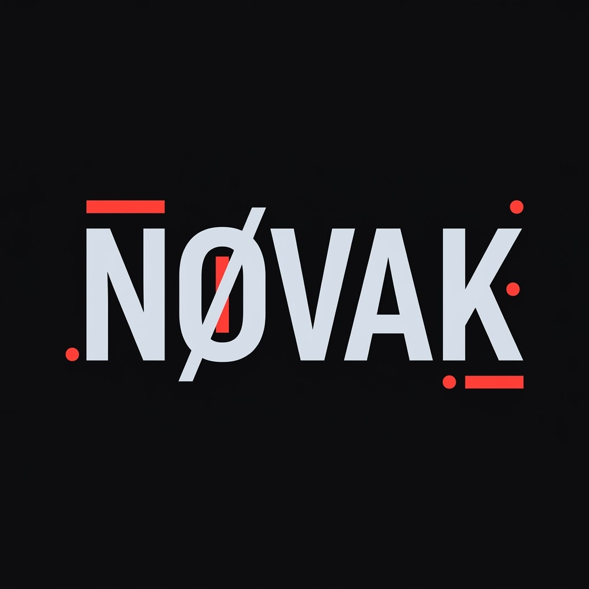
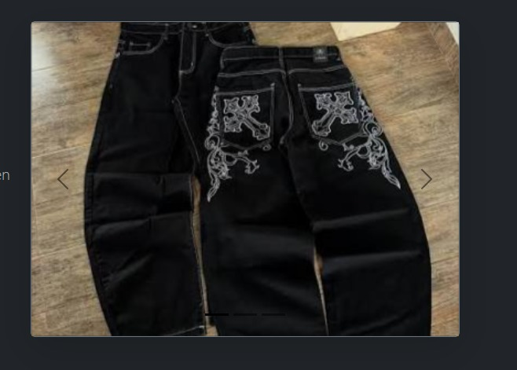
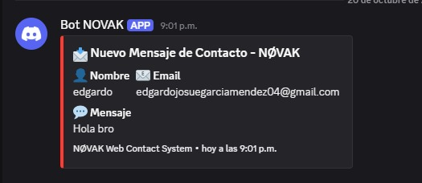
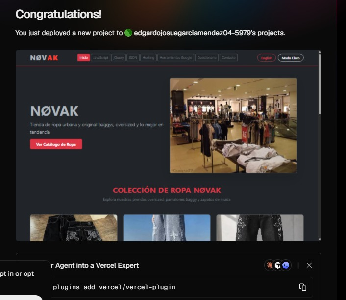
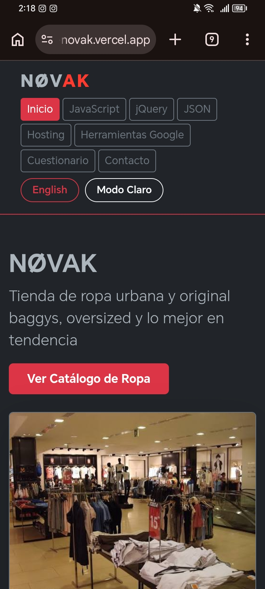
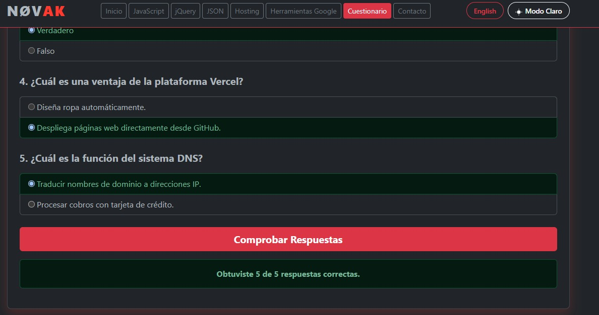
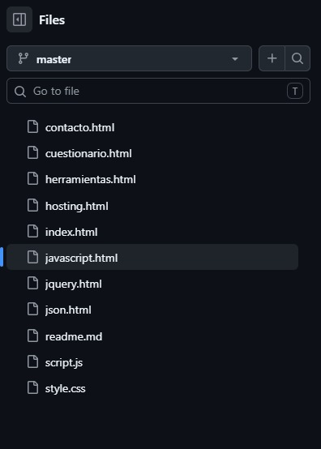

# 🗂️ Portafolio de Proyecto Web: NOVAK Streetwear

**Estudiante:** Edgardo Josué García Méndez
**Fecha:** 20 de Octubre de 2026
**Enlace al Sitio Web (Vercel):** productoproyecto-novak.vercel.app
**Repositorio GitHub:** https://github.com/edgardojosuegarciamendez04-afk/producto_proyecto-Novak/tree/master

---

. Identidad de Marca y Producto

📦 Ficha del Producto

- Nombre Comercial: NOVAK
- Descripción:NOVAK es una tienda de ropa, la cual abarca muchas de ls grandes marcas, ya sea: Adidas, Puma, Nike, Jordan, etc, ya sea en prendas o calzado.
- Público Objetivo: Personas las cuales quieran vestirse bien y como ellos siempre quisieron.
- Propuesta de Valor: Reunir contenido sobre videojuegos e información educativa de tecnologías web en un sitio visual, organizado e interactivo.

🎨 Diseño Visual
### Logotipo

Paleta de Colores:

Color| Código HEX| Uso en el sitio
Dominante| "#0a0a0c"| Fondo principal y secciones oscuras
Secundario| "#e2e8f0"| Botones y elementos destacados
Acento| "#ff3b30"| Detalles y elementos interactivos

La combinación de estos colores busca ofrecer una apariencia moderna relacionada con el mundo de la moda, La página utiliza las tipografías Segoe UI y fuentes del sistema.

Demostración del Carrusel (Bootstrap):

El carrusel de la página principal presenta imágenes de alta resolución enfocadas en tendencias urbanas: ropa *oversized*, zapatillas exclusivas y estilos *baggy*.

### Evidencia del carrusel

---

## 2. Investigación Técnica

Resumen informativo de los temas investigados en el proyecto:

1. JavaScript (Vanilla)

JavaScript es el lenguaje de programación encargado de añadir dinámica e interactividad al sitio web de NOVAK, JavaScript permite gestionar los eventos de usuario, manipular el DOM y controlar la lógica de la tienda.

Entre sus aplicaciones principales en el proyecto destacan:
- localStorage: Guarda las preferencias de tema e idioma para mantenerlas activas al navegar entre las 8 páginas.
- **Peticiones Asíncronas (fetch): Envía los datos del formulario de contacto directamente al Webhook de Discord sin recargar la página.
- **Cuestionario Interactivo:** Evalúa las respuestas del usuario en tiempo real mediante funciones y estructuras condicionales.

Ejemplo implementado en NOVAK:

2. jQuery 
jQuery es una biblioteca de JavaScript diseñada para simplificar la selección de elementos del DOM, el manejo de eventos y la creación de animaciones mediante una sintaxis abreviada.

Ejemplo:
$("#alerta-contacto").fadeOut();

Esta instrucción oculta de forma fluida el mensaje de confirmación del formulario de contacto, jQuery ayuda a reducir la cantidad de código escrito para manipular la interfaz.

3. JSON (JavaScript Object Notation)
JSON es un formato estándar y ligero para la estructuración e intercambio de datos organizados en pares de clave y valor. Es el estándar utilizado por APIs web para comunicar clientes y servidores.

En NOVAK, la estructura JSON se utiliza para definir el formato de los mensajes enviados hacia Discord y para simular la gestión del catálogo de prendas.

Ejemplo de datos de la tienda en NOVAK:

JSON
{
  "marca": "Nike",
  "producto": "Air Force 1 Nocta Drake",
  "categoria": "Zapataos",
  "precio": 80.00,
  "disponible": true
}
---

3. Integraciones Especiales

💬 Formulario de Contacto + Webhook de Discord

NOVAK cuenta con un formulario de contacto que solicita nombre, correo electrónico y mensaje.

Funcionamiento técnico:

1. El usuario completa el formulario en la página web.
2. Al enviarlo, la información se procesa mediante una solicitud.
3. Los datos se envían mediante webhook al servicio configurado para la integración con Discord.
4. Cuando el envío se realiza correctamente, aparece una notificación en el canal de Discord correspondiente.

---

4. Anexos y Evidencias Gráficas

🟢 Anexo 1: Integración con Discord (Formulario y Recepción)

### Formulario

### Discord

🟢 Anexo 2: Despliegue Exitoso en Vercel
### Vercel

🟢 Anexo 3: Diseño Responsive y Bootstrap

### Vercel

🟢 Anexo 4: Cuestionario Interactivo en Funcionamiento

### Cuestionario

🟢 Anexo 5: Estructura del Repositorio en GitHub

### Repositorio

---

5. Conclusiones y Autoevaluación

- Desafíos enfrentados:Cuando fui creando el proyecto me enfrenté a algunas cosas complicas como hacer el formulario y que llegue al mensaje a dsicord, que la pagina cambie de oscuro a claro  y encontar algunos errores de por qué algo no funcionaba.

- Aprendizajes clave: Aprendí un poco sobre hacer el formulario y que llegue el mensaje a discord porq no me ha quedado claro, hacer el readme porque es primera vez que lo hago y veo, y por ultimo he aprendido un poco sobre Javascript, json, yquery, etc.

(Me tardé 3 horas en buscar de como hacer para que el mensaje del formulario llegue a discord pero lo logré al final).
